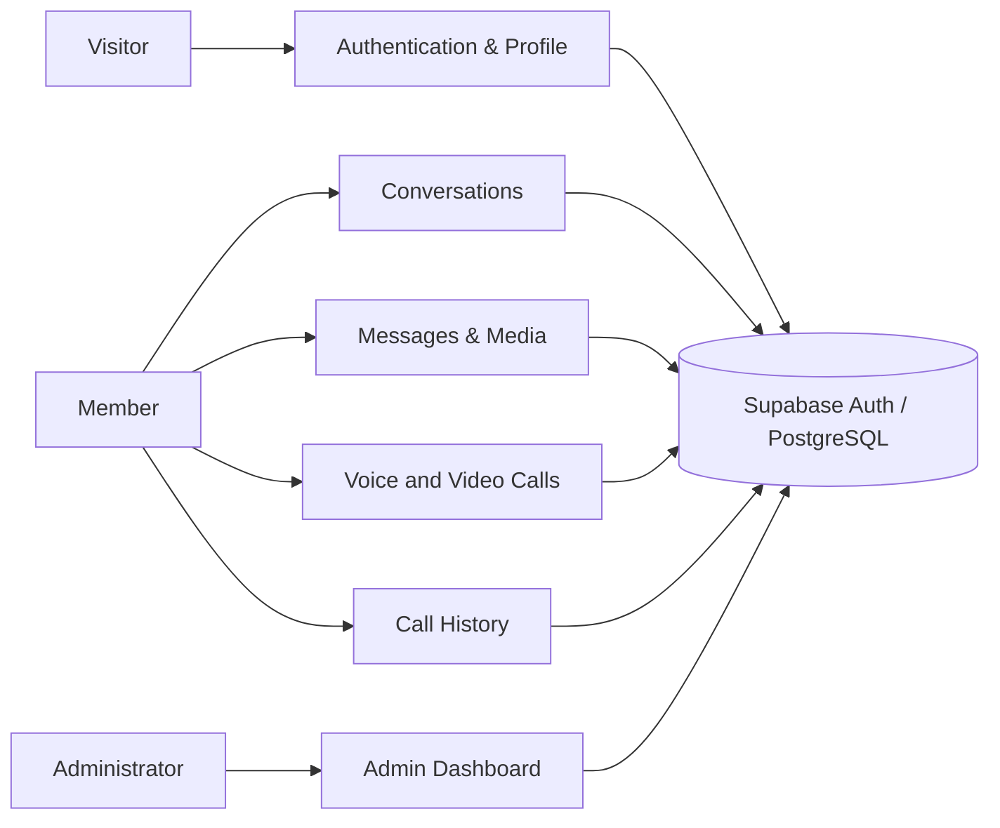
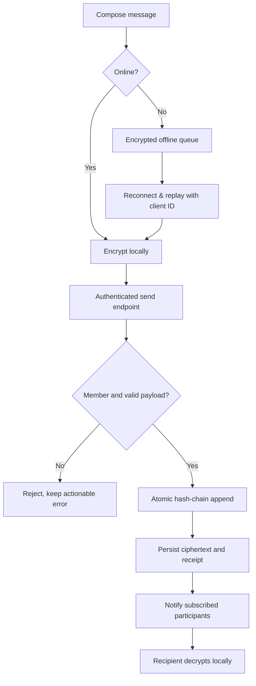
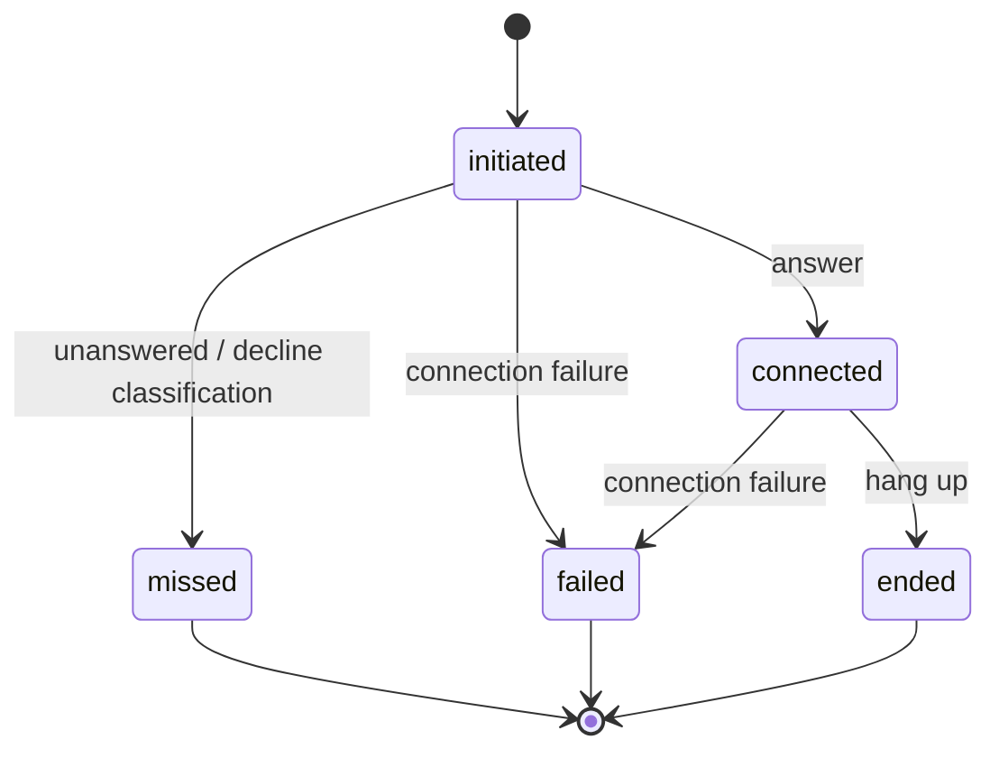

# Joschat Software Requirements Specification (SRS)
**Document ID:** JC-SRS-001 · **Revision:** 2.0 · **Baseline:** October 2026 · **State:** Release candidate, not production certified

## 1. Introduction
### 1.1 Purpose and audience
This document establishes testable requirements for Joschat, a browser/PWA messaging application. It is intended for product owners, implementers, QA engineers, security reviewers and operations staff. A requirement is *not* evidence that an implementation passed its acceptance test.

### 1.2 Scope and exclusions
In scope: authentication, profile setup, direct/group conversations, client-side encrypted messaging, permitted media, message integrity checking, offline outbox, voice/video calls, call history, administrative oversight, deployment security and accessibility.

Out of scope for this release: recording calls; multi-device private-key synchronization; guaranteed delivery when a device is permanently offline; identity attestation merely from a blockchain seal; general public access to administrative data.

### 1.3 Context and actors

## 2. Stakeholders and responsibilities
| Actor | Needs | Permissions boundary |
|---|---|---|
| Visitor | Understand product, sign up | No access to user content |
| Active member | Private communications | Only authorized conversation content |
| Group member | Talk within a group | Membership checked on each request |
| Administrator | Moderation, audits, operational statistics | Role checked server-side, no self-promotion |
| Operator | Migrations, recovery, deployment | Separate infrastructure credentials, not exposed to browser |
| QA reviewer | Evidence-based release decision | Dedicated test users and non-destructive fixtures |

## 3. Functional requirements
Each identifier is stable for testing and traceability.

| ID | Requirement | Priority | Acceptance evidence |
|---|---|---|---|
| FR-01 | Register with validated username, email, password and phone number | Must | Valid accepted, invalid rejected |
| FR-02 | Login, refresh and logout with Supabase-issued token | Must | Token lifecycle including expiry |
| FR-03 | Retrieve authenticated profile and reject suspended accounts | Must | API 403 for suspended |
| FR-04 | Create or reuse a direct conversation for a pair | Must | Repeated pair request does not duplicate |
| FR-05 | Create a group with an authorized participant set | Must | Membership and group listing test |
| FR-06 | Retrieve conversation history only for members | Must | Outsider receives denial |
| FR-07 | Encrypt message content before sending it to the API | Must | Server receives ciphertext |
| FR-08 | Append atomic integrity-chain evidence for sent ciphertext | Must | Concurrent append verified |
| FR-09 | Display message-integrity validation without claiming identity verification | Must | Tampered message fails validation |
| FR-10 | Support approved encrypted media upload/display | Must | Rejected unsafe file / oversize |
| FR-11 | Queue eligible text messages offline and reconcile safely on reconnect | Must | Duplicate replay yields one message |
| FR-12 | Start, answer, end and classify voice/video sessions | Must | Two-browser lifecycle trace |
| FR-13 | Display authenticated, paginated per-user call history | Must | Scoped results and pagination |
| FR-14 | Show administrator entry for administrators only | Must | Admin visible, ordinary user hidden |
| FR-15 | Enforce administrator permissions at every privileged API endpoint | Must | Standard user returns 403 |
| FR-16 | Suspend/reinstate another account and audit integrity | Must | Permission and self-suspend tests |
| FR-17 | Operate as installable PWA with graceful loss-of-network handling | Should | Install and offline tests |

## 4. Business rules
- Each conversation has explicitly registered participants; clients must not be allowed to infer authorization from a user-supplied conversation ID.
- A direct chat must be unique for the same unordered pair of users.
- A user may not set their own `role` or `status` through a public profile-write interface.
- Stored message content is encrypted before submission; integrity checking verifies consistency of stored encrypted bytes and their chain linkage, **not** that the sender is human or trustworthy.
- A call’s terminal outcome is immutable through ordinary client lifecycle operations.
- History reads must combine actor identity and conversation membership; pagination is bounded.
- An offline replay needs a stable idempotency key scoped to its author.

## 5. User workflows
### 5.1 Message lifecycle

### 5.2 Call outcome lifecycle

## 6. Non-functional requirements
| ID | Quality attribute | Verification target |
|---|---|---|
| NFR-01 | Authorization | All sensitive endpoints require verified identity plus object permissions |
| NFR-02 | Transport security | HTTPS in production; no secrets in client bundles |
| NFR-03 | Data confidentiality | No plaintext message body persisted by API |
| NFR-04 | Integrity | Hash-chain verification returns failure on tampered ciphertext |
| NFR-05 | Concurrency | Concurrent messages/calls must not create inconsistent records |
| NFR-06 | Reliability | Failed network requests yield retriable, understandable errors |
| NFR-07 | Performance | Call-history reads paginated with indexes; no unbounded list |
| NFR-08 | Compatibility | Supported desktop/mobile browsers; camera/mic permissions handled |
| NFR-09 | Accessibility | Keyboard-accessible dialogs, labelled controls and perceivable feedback |
| NFR-10 | Maintainability | Checked-in migration history, CI regressions, rollback guidance |

## 7. Interfaces
| Interface | Example | Authentication |
|---|---|---|
| Auth | `POST /api/auth/login`, `GET /api/auth/me` | Per endpoint |
| Conversations | `GET/POST /api/conversations` | Active member |
| Messaging | `POST /api/messages/send`, `GET /api/messages/<id>` | Conversation membership |
| Calls | `POST /api/calls/start`, `GET /api/calls/history` | Caller/recipient |
| Admin | `GET /api/admin/stats`, `GET /api/admin/users` | Admin role |
| Realtime | Supabase Realtime/Broadcast | Authenticated channel |
| Media | Cloudinary via server route | Validated media operation |

## 8. Acceptance and traceability
The test plan in **03_Test_Plan_and_QA_Report.md** maps FR-01–FR-17 and NFR-01–NFR-10 to reproducible test cases. Evidence must reference source commit, test environment, test identity and outcomes. Unexecuted cases are *Not Run*. Production approval requires both server-side authorization and real two-browser calling validation.

## 9. Risks and assumptions
Supabase Auth and Realtime and Cloudinary are external dependencies; WebRTC connectivity depends on the network and ICE configuration. A Vercel READY build does not prove calls or encrypted messaging work. The production Auth security advisor previously reported leaked-password protection disabled; this is a separate configuration gate.

## 10. Change control
After the release freeze, new requirements need explicit approval and a new baseline. Security and defect fixes must retain regression coverage and preserve historical messages, calls and integrity-chain data.

## 11. Plain-language explanation of the requirements

### What is a requirement?
A requirement is a rule the software must follow. It is not an announcement that the feature works. For example, "Only group members may read messages" describes the expected behaviour. A test must then sign in as a non-member and check that the server denies access.

### How someone uses the system, from beginning to end
A new person visits the website, creates an account, and supplies an email address, username, phone number and password. The account may need email confirmation depending on the authentication configuration. Once signed in, they search for another username and create or open a conversation. They can then send text and supported files, make direct voice or video calls, and review their own call history.

An administrator starts as an ordinary registered account. An authorised operator assigns that account the admin role in the database. After signing in, the administrator sees an Admin link and can open the dashboard. The server still checks the admin role for each request; a hidden button is not a security control.

### What happens if things go wrong?
- **Wrong password:** login fails with a useful message; no chat data is shown.
- **Expired session:** the app attempts a safe token refresh; if it fails, the user signs in again.
- **No internet:** an eligible message may wait in the outbox until connectivity returns.
- **Wrong chat ID:** the server refuses access to a conversation that the user does not belong to.
- **Rejected attachment:** the app explains that the type, size or transfer failed.
- **Call not answered:** the result is recorded accurately instead of pretending the call connected.
- **Integrity mismatch:** a suspicious message is flagged; the database must not silently rewrite the history.

### Requirement examples
**FR-06, private conversation:** Given Ama and Ben share a chat but Chris does not, when Chris requests that chat's messages, the server must refuse. The same rule holds if Chris changes the conversation ID in a request.

**FR-11, offline retry:** Given a message was queued while offline, when the device reconnects and retries it twice, exactly one final message should appear in the conversation.

**FR-15, administrator:** Given Ben is a regular user, when he opens the dashboard address or requests its statistics directly, he must not receive admin data.

### Terms in everyday language
| Term | Meaning |
|---|---|
| Authentication | Checking who is signing in |
| Authorisation | Deciding what that person is allowed to do |
| Encryption | Turning a message into unreadable data before it is sent |
| Message integrity | Checking whether the stored message has been changed |
| PWA | A website that can also behave like an installed app |
| Realtime | Updates that arrive without repeatedly refreshing the page |
| API | The application's secure connection between screen and server |
| RLS | Database rules limiting which records a user can see |

### How approval works
A requirement is accepted only after someone runs its matching test, records the result and checks that no privacy or data-loss issue remains. A green deployment indicator is only the start, not the finish.
