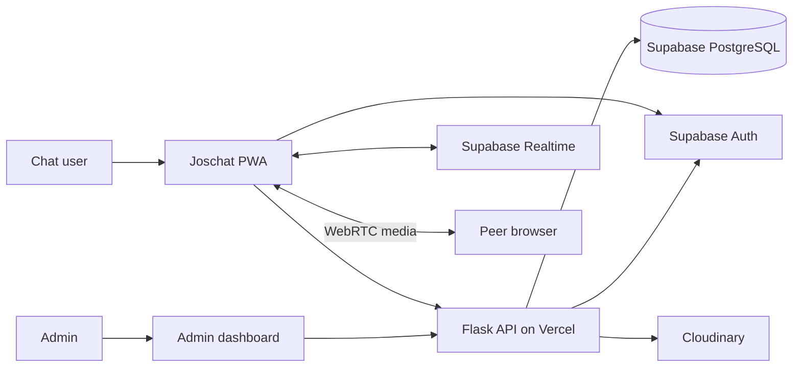
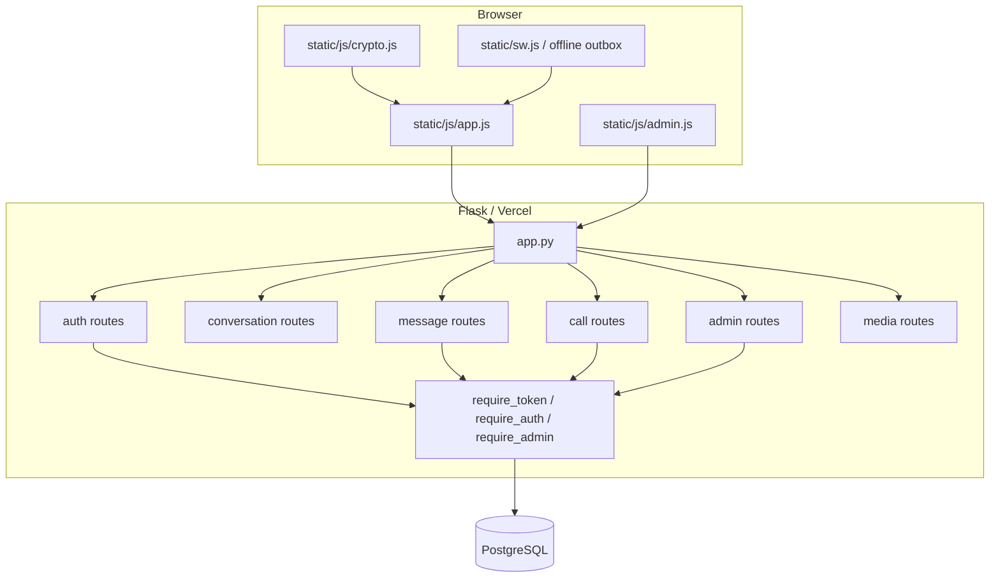
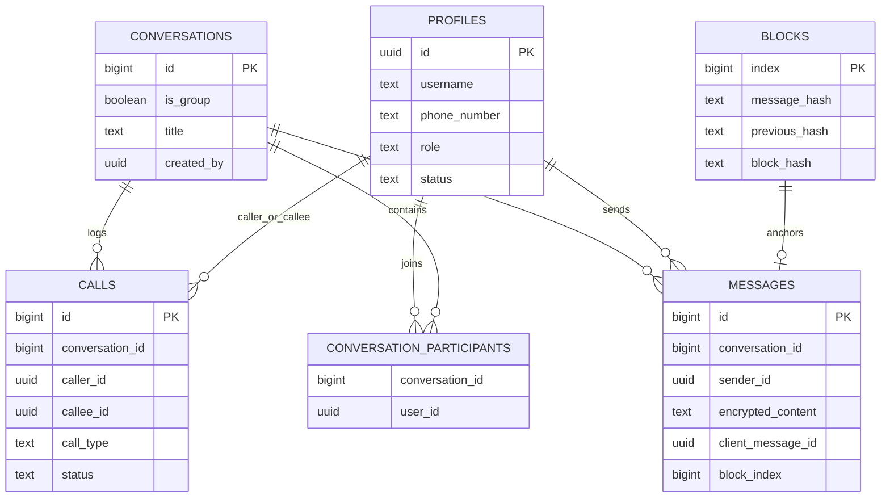
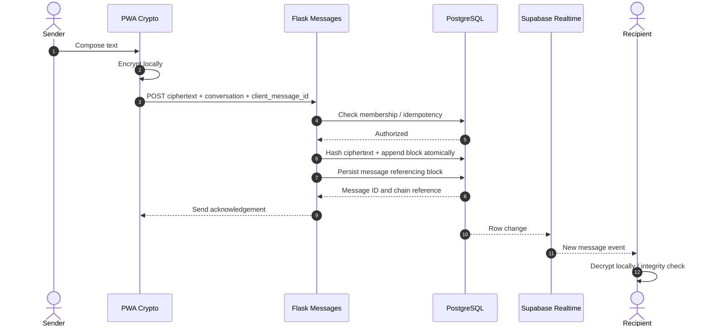
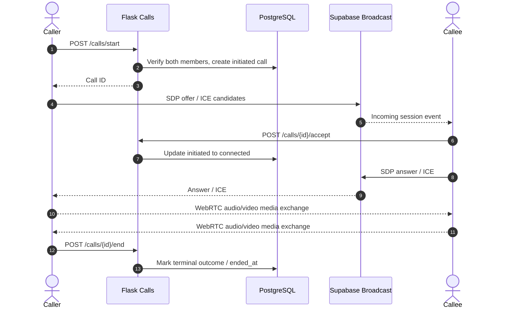
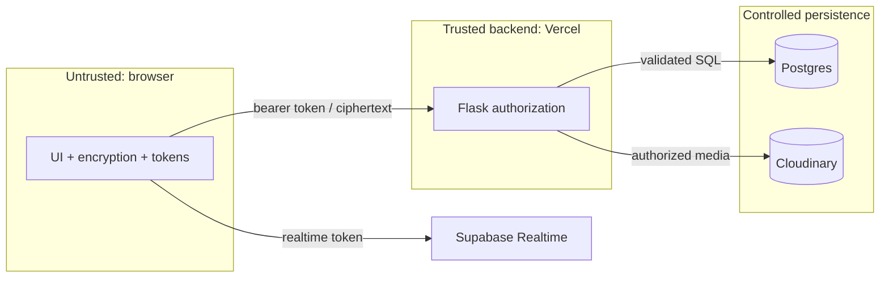

# Joschat System Design and Software Architecture
**Document ID:** JC-SDD-002 · **Revision:** 2.0 · **Baseline:** October 2026 · **Status:** Implementation-informed design

## 1. Architecture rationale
Joschat is a stateless Flask API deployed as serverless functions on Vercel, paired with a browser-based PWA. Supabase provides Auth, PostgreSQL and Realtime; Cloudinary holds media assets. WebRTC carries peer-to-peer voice/video where network conditions permit. Vercel functions do **not** host a persistent Socket.IO service. Supabase Broadcast is used for call signalling.

## 2. System context (C4-style)

## 3. Component diagram and source ownership

## 4. Data model (logical ER diagram)

This is a logical diagram, omitting audit, metadata and private operational columns. Use `supabase/schema.sql` and applied migration history for authoritative DDL; do not recreate a live database solely from the diagram.

## 5. Sequence: authenticated message send

### 5.1 Encryption/key management
Client-side code manages two documented paths: ECDH P-256 key agreement for direct chats where keys are available, and passphrase-derived AES-GCM keys for older/group contexts. Key availability varies by device. The private key must not be sent to Flask. Public-key changes should require explicit trust decisions. The SHA-256 chain hashes ciphertext, *not* a plaintext transcript.

### 5.2 Offline delivery
A service worker plus IndexedDB outbox can retain eligible encrypted messages during network loss. Replays include a client-generated identifier; uniqueness scoped to sender limits accidental duplicate delivery. Retry outcomes must distinguish transient errors from permanent authorization or validation failures.

## 6. Sequence: call setup and record

### 6.1 Call history
`GET /api/calls/history?limit=30&offset=0` returns only authenticated caller/recipient rows for conversations the user currently belongs to. Database indexes on caller, callee and conversation plus descending start date support paging. Ordinary users cannot access someone else's call history via a client-supplied ID.

## 7. Data flow / trust zones

### Security safeguards
1. Only Supabase Auth validates user tokens; backend then resolves active `profiles` identity.
2. `require_admin` is attached to every privileged route; hiding a UI link alone never secures it.
3. Browser roles are restricted with RLS, with database-side policies and separate backend operations.
4. Backend-only hashing/audit functions should not be inadvertently granted to `anon` or `authenticated`.
5. Direct database connections must remain on server-side configurations; never embed credentials in PWA JavaScript.
6. Use rate limits, size controls, safe errors, CSRF review (if cookies adopted), and strict CORS on deployment.

## 8. Failure modes and operational expectations
| Failure | Expected handling |
|---|---|
| Access token expires | Refresh once, else require re-login |
| Supabase unavailable | Surface unavailable state, avoid unauthorized fallback |
| Cloudinary rejects media | Show validation failure, retain draft when possible |
| Realtime disconnected | Fall back to polling for messages where supported |
| WebRTC permission denied | Show actionable user guidance; log failure appropriately |
| Duplicate call start | Reject active duplicate within same conversation |
| Outbox duplicate replay | Same sender/client ID resolves to same message |
| Blockchain mismatch | Flag integrity issue; never silently amend historical block |

## 9. Deployment topology and dependencies
GitHub `Simmyt3r/JosChat` -> Vercel build -> Flask API/PWA at `joschat.vercel.app`; production environment keys reference the verified Supabase project `fruldgczvyvumgmwmbqj`. Verify hosting environment values from approved dashboards, not from documentation or example secrets.

## 10. Architectural trade-offs
Serverless avoids persistent backend sockets but relies on Supabase Realtime for signalling; browser crypto protects plaintext but complicates recovery and cross-device key reuse; append-only blockchain validation improves integrity evidence but does not independently authenticate human identity; direct PostgreSQL backend access requires particularly careful endpoint authorization. These trade-offs inform the QA gates.
