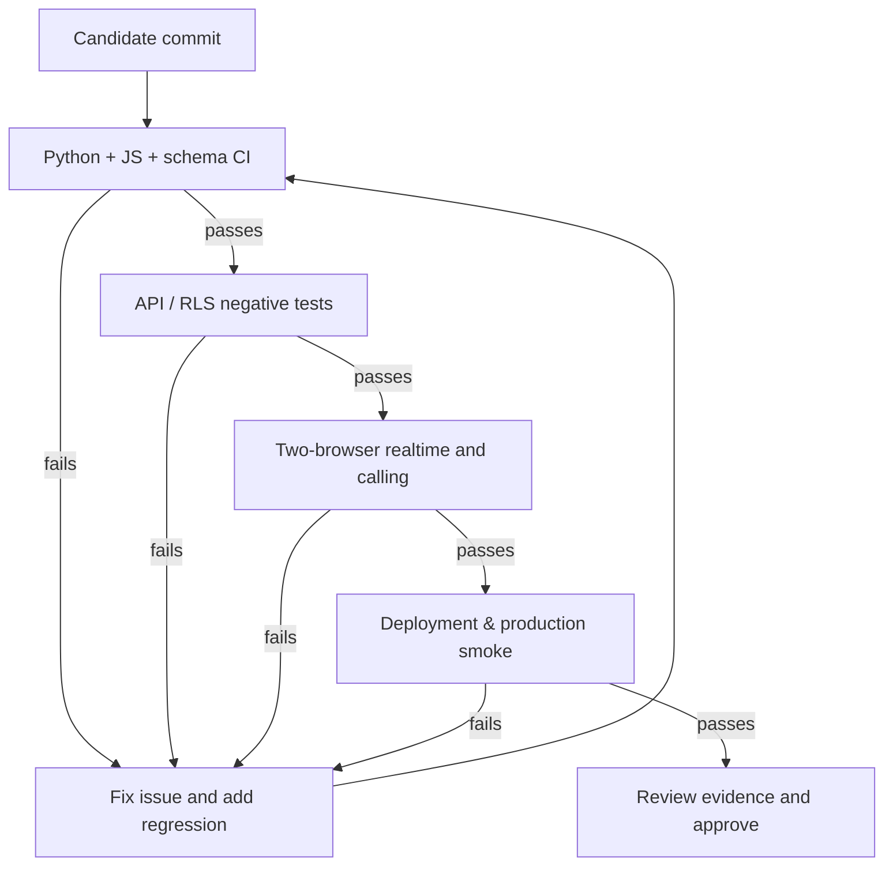
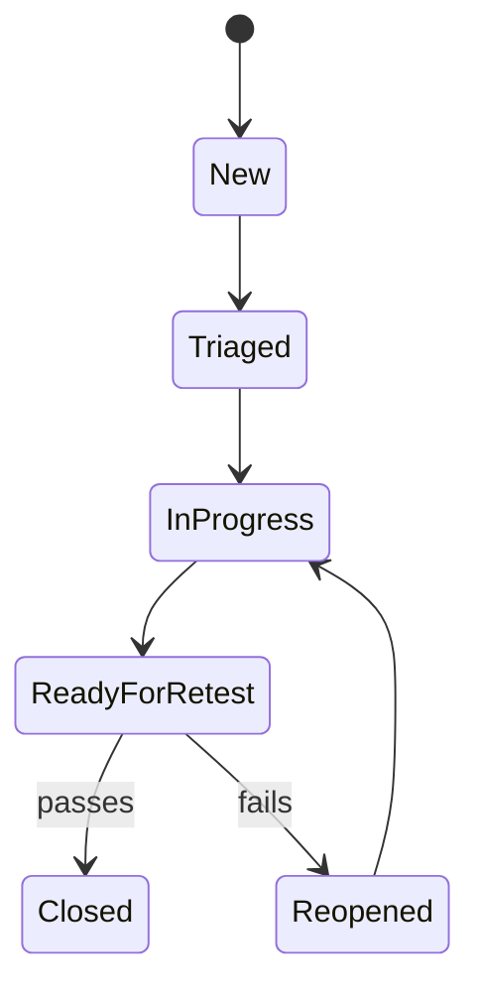

# Joschat Software Test Plan and QA Report
**Document ID:** JC-TP-003 · **Revision:** 2.0 · **Baseline:** October 2026

> **Evidence note:** This is a complete validation plan and historical observations, not a fabricated PASS report. Any test without execution evidence is **Not Run**.

## 1. Scope and strategy
Verify functional flows, access control, encryption/integrity, concurrency, offline resilience, calls, admin operations, and Vercel/Supabase deployment. Use layered tests: unit -> API integration -> database/RLS -> two-browser end-to-end -> production smoke.

## 2. Test environments
| Environment | Purpose | Protection |
|---|---|---|
| Local Python / ephemeral PostgreSQL | Route + schema tests | Mock external services; discard test rows |
| Vercel preview + isolated database | End-to-end regression | Two users plus standard/admin fixture |
| Production Vercel + verified Supabase | Read-only smoke and explicitly approved safe interactions | Never delete user history |
| Live endpoints | Release signoff | Record URL, SHA, time and browser |

Baseline: `Simmyt3r/JosChat`; Vercel `joschat`; Supabase `fruldgczvyvumgmwmbqj`.

## 3. Test execution workflow


## 4. Detailed test cases
| ID | Requirement | Procedure | Expected outcome | Execution |
|---|---|---|---|---|
| AUTH-01 | FR-01 | Register valid identity; then malformed username/phone | Valid created; malformed rejected | Not Run |
| AUTH-02 | FR-02 | Login, refresh expired token, logout | New token on refresh, revoked/expired denied | Not Run |
| AUTH-03 | FR-03 | Suspend test profile and access API | 403, no application data | Not Run |
| CONV-01 | FR-04 | Create same direct pair twice | Same conversation returned | Not Run |
| CONV-02 | FR-05/06 | Create group; outsider fetch | Members can view, outsider 403 | Not Run |
| MSG-01 | FR-07 | Inspect API insert for test message | Ciphertext only, no plaintext | Not Run |
| MSG-02 | FR-08/09 | Concurrent sends + integrity scan | Linked blocks; messages verify | Not Run |
| MSG-03 | FR-09 | Mutate ciphertext in isolated test DB | Integrity verification rejects | Not Run |
| MSG-04 | FR-11 | Queue offline and replay same ID twice | One durable message | Not Run |
| MEDIA-01 | FR-10 | Valid and invalid uploads | Valid accepted, oversized/bad type rejected | Not Run |
| CALL-01 | FR-12 | Two browsers: voice answer and hang up | Both receive audio, record ended | Not Run |
| CALL-02 | FR-12 | Two browsers: video, deny camera | Video or actionable failure | Not Run |
| CALL-03 | FR-12 | Decline, unanswered, dropped session | Correct terminal outcome recorded | Not Run |
| CALL-04 | FR-13 | Page 1 and page 2 of call history | Ordered, nonduplicate, correct direction | Not Run |
| CALL-05 | FR-13 | Standard user attempts foreign call | No other user's call details | Not Run |
| ADM-01 | FR-14/15 | Admin login and same-tab Admin entry | Authorized dashboard loads | Not Run |
| ADM-02 | FR-15 | Ordinary user calls /api/admin/stats | 403, independent of UI | Not Run |
| ADM-03 | FR-16 | Admin suspend/reinstate test user | Correct audited status transitions | Not Run |
| PWA-01 | FR-17 | Install, reload offline, reconnect | Shell loads; queued messages reconciled | Not Run |
| SEC-01 | NFR-01/03 | Inspect browser bundle + RLS cross-user tests | No backend secret; private rows denied | Not Run |
| OPS-01 | NFR-10 | Run migrations twice in isolated DB | No unintended mutation/history loss | Not Run |

## 5. Existing automated test inventory
Repository currently includes `tests/test_auth_routes.py`, `tests/test_messages_route.py`, `tests/test_calls_route.py`, `tests/test_admin_route.py`, `tests/test_schema_integration.py`, plus `tests/e2e/` browser scripts and `tests/js/crypto.test.js`. This inventory is **not** a statement that all suites were run for this revision.

### Recommended commands in the test environment
```bash
python -m pytest -q
node --test tests/js/*.test.js
```
Use the repository's GitHub Actions workflow for Postgres-backed integration. Browser scripts have separate prerequisites documented in `tests/e2e/README.md`; do not claim automated browser coverage without running them.

## 6. Sample defect lifecycle


## 7. Quality gates
**Blockers:** unauthorized data exposure; plaintext leakage; broken login or administration; invalid blockchain audit; duplicate offline purchases/messages; crash on basic flows; WebRTC not connecting under supported environments; irreversible migration or unresolved credential leak.

**Exit criteria:** all critical cases passed on final commit; no open P0/P1 defects; security advisor reviewed; real-browser admin workflow confirmed; migration rollback and backups verified; Vercel deployment SHA matched; product owner signed off.

## 8. Evidence record template
| Field | Value to record |
|---|---|
| Test ID | e.g. CALL-01 |
| Build SHA | full SHA |
| Environment / browser | URL and versions |
| Tester / timestamp | name, ISO date/time |
| Preconditions | identities, data fixtures |
| Expected / actual | precise values |
| Result | Pass / Fail / Blocked / Not Run |
| Defect reference | issue link |
| Evidence | log/screenshot path, redacted |

## 9. Historical verified observation, not current acceptance
A prior Supabase release migration was recorded as applied; counts observed at that time were 13 calls, 14 messages, 14 blocks, and three call-history indexes. These do **not** confirm the current production test results. A past Vercel deployment showed READY, but final browser/admin release gates remain unverified.

## 10. Release disposition
**Release candidate: feature frozen; production certification pending evidence.** Any “PASS” value must be entered only after actual execution and review.
