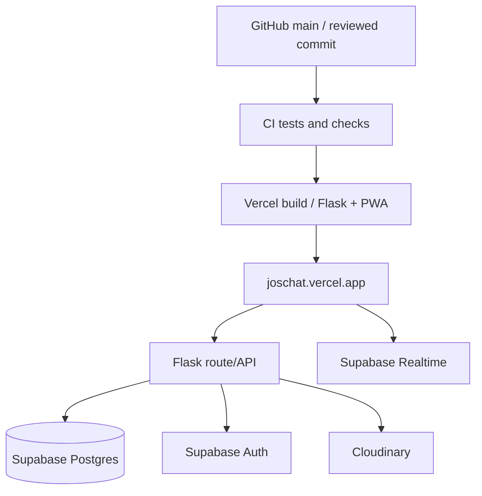
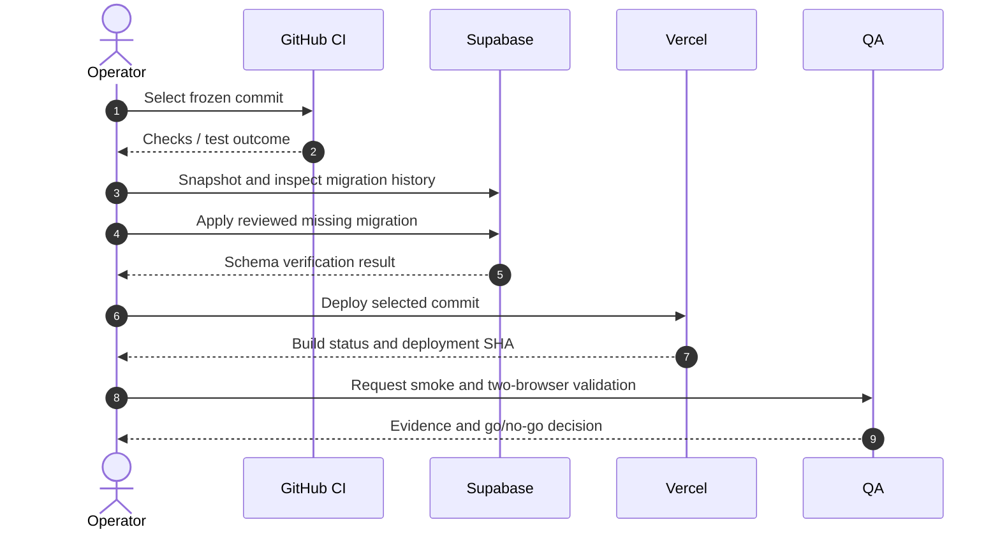
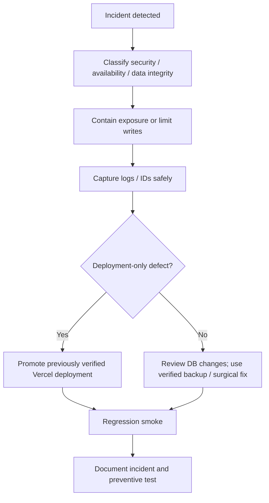
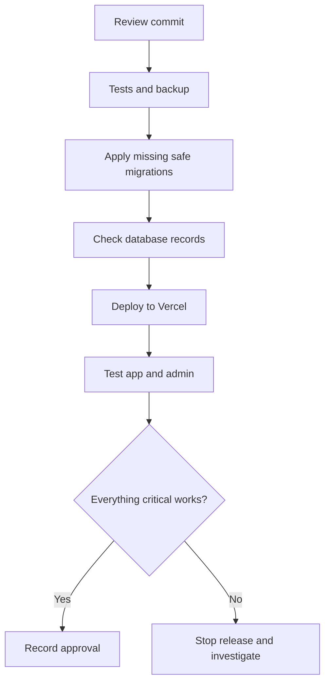

# Joschat Deployment, Operations and Maintenance Guide
**Document ID:** JC-OPS-004 · **Revision:** 2.0 · **Baseline:** October 2026

## 1. Operational ownership and boundaries
Application: `Simmyt3r/JosChat`; production domain: https://joschat.vercel.app; Vercel project: `joschat`; verified Supabase project: `fruldgczvyvumgmwmbqj`. Cloudinary is used for media. The release candidate freeze is recorded in `RELEASE_FREEZE_2026-10-16.md`.

## 2. Deployment topology

## 3. Environment inventory (names only)
Production secrets and configuration must be stored in Vercel/Supabase, never in documentation or source control. Inspect `config.py`, `.env.example` and Vercel settings for authoritative keys. Typical categories include:
- Supabase URL and browser publishable/anon key;
- backend PostgreSQL connection URL;
- Cloudinary storage credentials;
- Flask application security configuration;
- any configured push, cron, signing or notification keys.

**Never** copy production credential values into test reports, GitHub issues or user-facing screenshots.

## 4. Pre-deployment checklist
- [ ] Confirm specific release SHA and freeze scope.
- [ ] CI Python, JavaScript and integration tests pass.
- [ ] Run negative authorization and live two-user call tests.
- [ ] Backup Supabase tables / confirm restore method and recovery owner.
- [ ] Compare schema migration history with repository and resolve drift.
- [ ] Confirm production Vercel environment points to the intended Supabase project.
- [ ] Verify no privileged key is exposed to browser variables.
- [ ] Confirm Supabase Auth security warnings are reviewed.
- [ ] Prepare rollback candidate and staff communication.

## 5. Deployment sequence

### Applying migrations safely
1. Inspect `supabase/migrations/` and database migration history first.
2. Review every DDL statement for irreversibility or changes to existing rows.
3. Apply through the approved Supabase migration workflow to the **verified** project.
4. Query indexes, policies, row counts and functions after applying.
5. Do not copy a full historical `schema.sql` blindly into a populated project.
6. Preserve message, call, and block evidence. Existing ledger rows must not be deleted to repair a failure.

The call-history release hardening migration was previously recorded and verified; reapplying it as a new migration is not needed.

## 6. Smoke test checklist
| Endpoint/workflow | Expected result |
|---|---|
| `/` and `/app` | Landing and app render |
| `/admin` | Page renders; privileges validated via API |
| `GET /api/auth/me` with valid token | Correct account/profile and role |
| `GET /api/admin/stats` with ordinary token | 403 |
| Direct/group messages | User can send/receive, outsiders denied |
| WebRTC and call history | Two-party call + stored outcome |
| Offline outbox | Retry without duplicate delivery |
| Integrity audit | Expected validation result |

## 7. Monitoring and diagnosis
Check Vercel deployment inspector, build status, runtime error logs within plan retention, Supabase auth activity, database health, and Cloudinary errors. Correlate by request time, deployment ID and path. A READY build alone never certifies the application.

**Admin-access diagnostic:** confirm the signed-in `/api/auth/me` profile role; verify same-tab session; verify `/api/admin/stats` HTTP response; check 401 vs 403 vs 5xx; avoid bypassing `require_admin`.

## 8. Incident response

## 9. Maintenance calendar
| Frequency | Action |
|---|---|
| Each release | CI, database backup, deployment SHA and smoke evidence |
| Weekly | Security advisor, auth warnings, error log review |
| Monthly | Restore drill in isolation; dependency and permissions audit |
| Quarterly | Key rotation plan, disaster recovery and admin access review |
| After incidents | Root-cause analysis, added regression and corrective action |

## 10. Backup and restoration principles
Back up before schema changes and verify the restoration destination; test restores on an isolated environment. Define RPO/RTO with the owner rather than inventing figures. Rotate compromised keys and invalidate sessions as necessary. Restoration of immutable audit or block history requires specialist review of chain integrity.

## 11. Security release findings
Supabase previously warned leaked-password protection was disabled; enabling it is an Auth project setting, not a schema migration. Several RLS-enabled private tables intentionally lacked browser policies. Evaluate GRANTs/RLS together before adding any broad access. Never weaken policies just to silence an advisor.

## 12. Change management and signoff
All post-freeze modifications must be release-blocker fixes with tests, review, documented migration and rollback. Production certification requires signoff against the QA matrix. Do not describe a commit or deployment as “validated” solely because it built.

## 13. Straightforward operator walkthrough

This guide is intended for whoever manages Joschat on GitHub, Vercel and Supabase. **Do not make a production database change simply to clear a warning.** Every change needs a backup, a reason and a way to recover.

### Understand the three main dashboards
- **GitHub:** where application code and documentation are stored, reviewed and versioned.
- **Vercel:** where Joschat is built and published to its website.
- **Supabase:** where accounts, messages and call records live, and where database permissions are enforced.

### Safe release in nine steps
1. Choose the exact GitHub commit intended for release.
2. Check whether the automated tests passed for that commit.
3. Review the pending changes for secrets and accidental data deletion.
4. Take a database backup and confirm that it can be restored.
5. Compare new migrations with the database's already applied migration history.
6. Apply only approved missing migrations, in the correct order.
7. Check that message, call and integrity-record counts have not changed unexpectedly.
8. Let Vercel deploy the intended commit and verify that the displayed commit matches.
9. Log in as a normal user and an administrator, and perform the smoke tests before signoff.

### If administrators cannot log in
First establish whether the user has signed into `/app` on the same browser tab. Next check the server's `/api/auth/me` response to see which account is recognised and whether its role is admin. Then check `/api/admin/stats`: **401** means not authenticated, **403** means authenticated but not permitted, and **5xx** indicates a server problem. Do not bypass administrator checks to make the page load.

### If a message cannot be delivered
Check connectivity and the offline queue. Verify the session remains valid. Inspect application errors without printing plaintext messages or access tokens. Confirm database and Realtime health. Test retry using a sample message before assuming the issue has been fixed.

### If a migration fails
Stop and capture the specific error. Check which statements ran and whether the migration history was recorded. Compare actual database structure with the expected schema. Recover using reviewed reversible changes or a verified backup; do not remove the immutable message ledger.

### If a new deployment breaks the app
The usual first recovery is to return Vercel to a previously tested deployment, **provided the old code is compatible with the current database**. Rolling back application code alone does not undo a database migration.

### Maintenance journal
| Record | Example field |
|---|---|
| Date and operator | Who handled the change and when |
| Change summary | Bug fixed or security rule improved |
| Before/after | Git SHA and deployment ID |
| Database effects | Migration name and verified row counts |
| Tests | Tests executed and their outcome |
| Recovery | Known-good deployment and backup location |
| Approval | Release decision and reviewer |

### Terms worth knowing
A **migration** changes database structure. A **deployment** publishes software. A **rollback** returns to a previous working version. A **backup** is a recoverable copy of data. A **smoke test** quickly checks that the most important functions still work. A **security advisory** is a warning to investigate, not an instruction to run arbitrary SQL.
