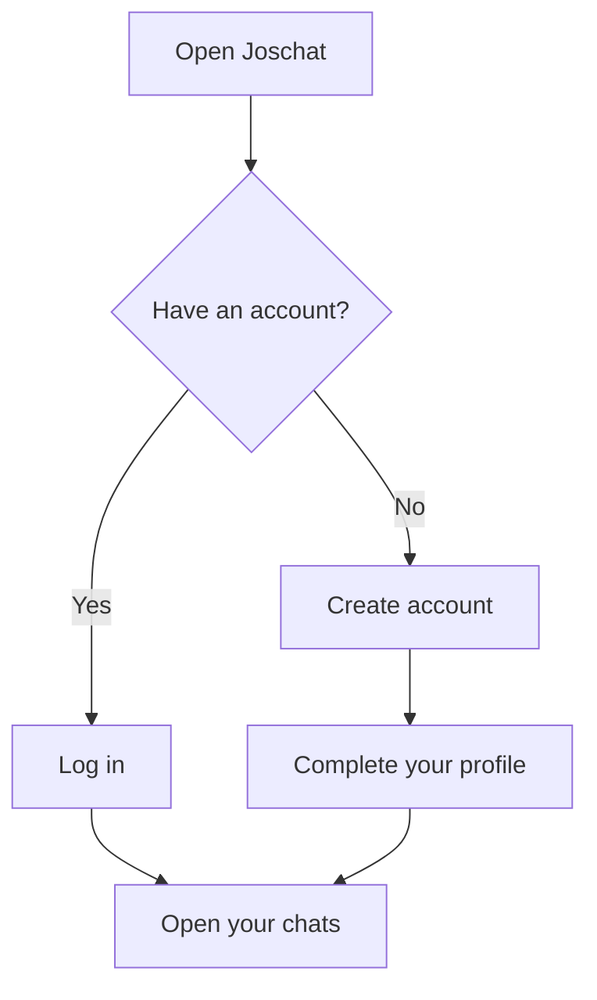
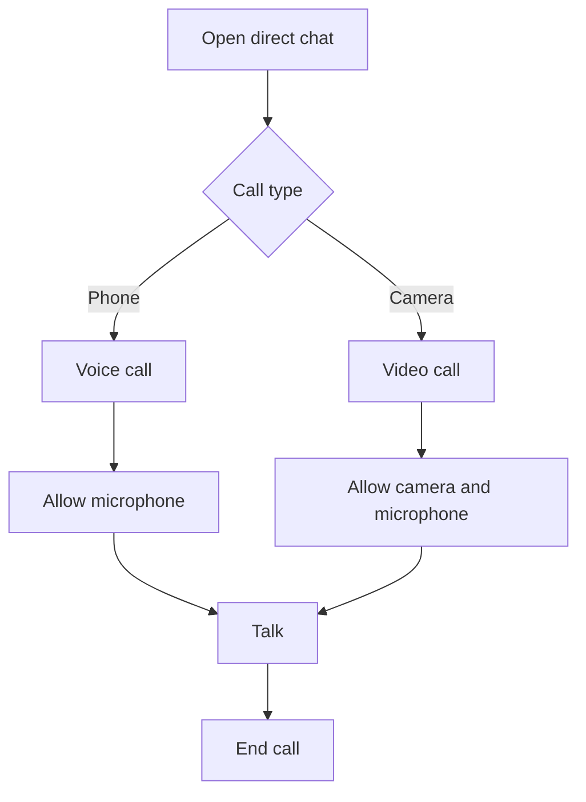

# Joschat User Manual
**Document ID:** JC-UM-005 · **Revision:** 2.0 · **Simple step-by-step guide**

Welcome to Joschat, a place to message people, share files and make voice or video calls. You only need a phone or computer with an internet browser.

## 1. Open Joschat
Go to **https://joschat.vercel.app/app**.

- New user? Choose **Create account**.
- Already registered? Choose **Log in**.

Enter the details requested on the screen. Keep your password private.

## 2. Send your first message
1. Find the **Search or start a chat** box.
2. Enter your friend's username.
3. Select that person.
4. Write a message at the bottom of the chat.
5. Press **Send**.

**Tip:** If a message will not send, check your internet connection.

## 3. Create a group
1. Select **New group**.
2. Enter the usernames of people you want in the group.
3. Add a group title if asked.
4. Confirm to create the group.

## 4. Share a photo or file
1. Open the conversation.
2. Select the attachment icon.
3. Choose a supported file.
4. Send it.

If Joschat rejects the file, its size or type might not be supported.

## 5. Make a voice or video call
1. Open a direct chat.
2. Tap the **phone** icon for a voice call or the **video camera** icon for a video call.
3. Allow microphone or camera permission when your browser asks.
4. Tap the **hang-up** control when finished.

## 6. Check your call history
1. Open the chats screen.
2. Select **Call history**.
3. See whether calls were incoming, outgoing, answered or missed.
4. Select **Load more** if you want older records.

## 7. Understand the Verified badge
A **Verified** label means Joschat checked the stored message's integrity record. It **does not** mean the person or the information in the message has been verified.

## 8. When you are offline
If the network drops, some messages may be kept in the queue and sent after the connection returns. Reopen the app when online and confirm delivery before assuming a message reached someone.

## 9. Admin instructions (only for approved administrators)
1. Log in normally at **/app**.
2. Use the **Admin** link in the header.
3. Open the dashboard to view permitted platform tools.
4. If the page says **Admins only**, make sure you signed in with an administrator account, in the **same browser tab**.

Admin dashboard: https://joschat.vercel.app/admin

## 10. Common problems
| Problem | What to do |
|---|---|
| Cannot log in | Check login details, then internet connection |
| Friend not found | Check the exact username |
| Message stuck | Reconnect and try the queue again |
| Call has no sound | Allow microphone and check device volume |
| Camera not working | Allow camera permission in browser settings |
| Admin page refuses access | Sign in again with the correct admin account in the same tab |
| A file will not upload | Try a smaller supported file |

## 11. Keep your account safe
Do not share passwords or verification codes. Do not open suspicious links or send sensitive details to strangers. Log out of shared devices when finished.

**Need more help?** Contact your Joschat administrator or technical support through the organization's approved support channel.
