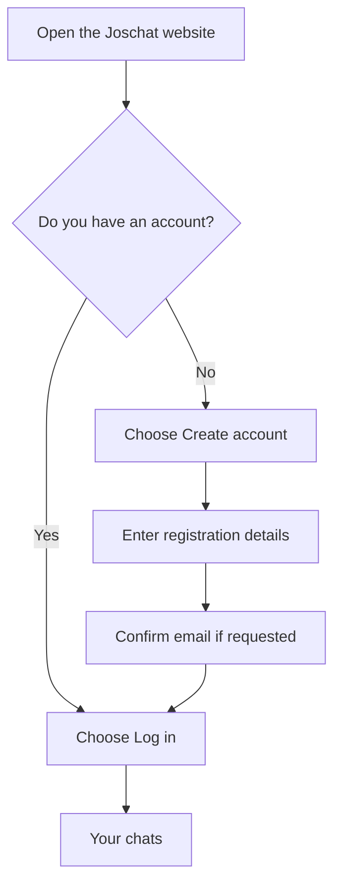
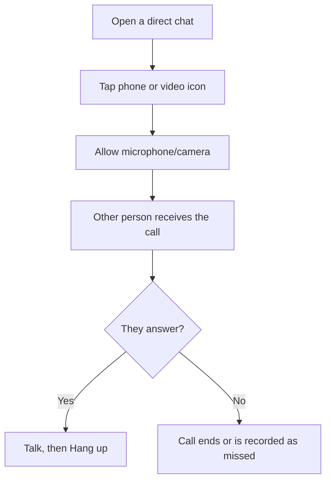

# Joschat User Manual
**Version 3.0 | October 2026 | Beginner-friendly guide**

This guide explains Joschat using ordinary words. Follow the steps in order if this is your first time using the app. Some features depend on your browser, internet connection, account permissions and the current release.

## Contents
1. Open Joschat
2. Create an account
3. Confirm your email and log in
4. Understand the chat screen
5. Find someone and start chatting
6. Send a message
7. Make a group
8. Send photos, videos and audio
9. Read locked messages
10. Check the Verified label
11. Use Joschat without internet
12. Make voice and video calls
13. View call history
14. Change theme and security settings
15. Open the Admin dashboard
16. Troubleshoot common problems
17. Keep your account and messages safe
18. Quick reference

## 1. Open Joschat
1. Open Chrome, Edge, Safari or another modern web browser on your phone or computer.
2. Type **https://joschat.vercel.app/app** into the address bar.
3. You will see **Log in** and **Create account** options.
4. Choose the option that matches your situation.

**What you need:** internet access to register and sign in, plus an email address and a password.

## 2. Create an account
1. Select **Create account**.
2. Enter a **username**. It is the name others will search for to find you. Your name can contain 3–30 letters, numbers, underscores, dots or hyphens.
3. Enter your **phone number**. The registration screen says it is required and kept private.
4. Enter an **email address** that you can access.
5. Enter a password that you do not reuse elsewhere.
6. Select the registration button and read any message shown on the screen.

**Example:** A username such as `Grace_2026` is different from the email address used for login. Other people search for your username, not your password.

If the username is rejected, check its length and symbols. If the account already exists, use **Log in** instead of repeatedly creating accounts.

## 3. Confirm your email and log in
If Joschat shows **Check your email**:
1. Open the inbox for the address you registered.
2. Find the confirmation message and follow its link.
3. Return to Joschat, select **Back to log in**, and enter your email and password.

If no email confirmation is requested, follow the next instruction shown by Joschat.

To sign in later, choose **Log in**, enter your **email** and **password**, and submit the form. If the screen requests a username and phone number after login, complete the profile form so the account can be used.

**Important:** Your username is for other users to identify you; the login form expects your email address.

## 4. Understand the chat screen
The main screen has a **chat list**, a **conversation area**, and controls in the header.

| What you see | What it does |
|---|---|
| **Search or start a chat** | Find an existing conversation or look for a username |
| **New group** | Start a conversation with several people |
| **Call history** | Show past incoming and outgoing calls |
| **Your username** | Shows the account currently signed in |
| **Moon/sun icon** | Switch between light and dark appearance |
| **Security and keys** | Open encryption-key information |
| **Admin** | Opens admin tools if your account has permission |
| **Sign out** | Ends the session on the current device |
| **Chat list** | Choose an existing discussion |

On a narrow phone screen, the chat list and opened chat may appear one at a time. Use the **Back to chats** arrow to return to the list.

## 5. Find someone and start chatting
1. Tap **Search or start a chat**.
2. Type the person's **username**, without guessing their email.
3. If an existing conversation appears, select it.
4. If Joschat offers **Start a new private chat**, select that option.
5. The conversation opens. You can now type.

If the person cannot be found, check the username spelling and whether the person has actually registered.

## 6. Send and read a message
1. Open a conversation.
2. Tap the message box at the bottom.
3. Type what you want to say.
4. Select **Send** (the paper-plane icon).
5. Check whether the message appears in the conversation.

**Reading replies:** Incoming messages should appear in the same conversation. Joschat may update them live. If the connection is interrupted, reconnect or reopen the conversation.

**Before sending:** Check that you opened the correct person's chat. Messages are not an appropriate place to put passwords or verification codes.

## 7. Make a group conversation
1. From the chat list, select **New group**.
2. Enter the usernames of the people to include. The form permits names separated by commas or spaces.
3. Enter a group title where requested.
4. Confirm the form.
5. Find the new group in the chat list and open it.
6. Send a message in the group just as you would in a direct chat.

You are included automatically when creating a group. Check the displayed group members so you do not share private information with the wrong participants.

## 8. Send a photo, video or audio file
1. Open the intended conversation.
2. Tap the **attachment/paperclip** button beside the message composer.
3. Choose a file from your device.
4. Review the selected attachment and remove it if you picked the wrong file.
5. Select **Send**.

Joschat is configured to accept supported images, videos and audio formats, with an upload size ceiling of approximately **25 MB** per file. Unsupported formats or files that are too large may be refused.

**If an upload fails:** Check your connection, file format, size and browser access to files. Do not keep tapping Send before checking whether the first attempt succeeded.

## 9. Understand locked conversations and encryption keys
Joschat protects message contents using encryption. This means the message is changed into unreadable data while being transmitted and stored.

In some direct chats, Joschat can use **secure keys** from your device. Older chats, group chats or conversations without matching keys may use a **shared passphrase**.

### If you are asked for a shared passphrase
1. Ask the other participant for the passphrase through a separate trusted method.
2. Open the conversation.
3. Follow the **Unlock** or passphrase instructions shown.
4. Enter the same passphrase used by the other participant.
5. Try reading the older messages again.

If the passphrases do not match, the messages may remain unreadable. **Do not email or post the passphrase publicly.**

### If you see a security-key warning
Open **Security and keys** and read the message carefully. You may be using a different device, or someone's public key may have changed. Do not accept unexpected changes without checking with that person.

**Important limitation:** A password reset or device change does not necessarily recover encrypted messages if you no longer have the required local keys or passphrase.

## 10. Understand the Verified label
Joschat checks a stored message against an integrity record. A **Verified** label means the stored encrypted message passed that check.

It **does not** mean:
- the person's identity was independently verified;
- the claim in the message is true;
- the file or link is harmless.

You can select **Verify chat** to request another integrity check. If the app flags a mismatch, stop relying on that record and report the problem to the administrator.

## 11. Use Joschat when the internet goes off
Joschat is designed as a **progressive web app (PWA)**. Parts of it may remain usable after they have loaded once.

### If you compose a message while offline
1. Write the message as normal where the offline feature is available.
2. Look for the offline banner or queued-message notice.
3. Reconnect to the internet.
4. Allow Joschat to retry, or select **Retry** on the outbox notice.
5. Confirm the message has actually appeared as delivered.

You may also see an option to remove a queued message. Use this if you sent it to the wrong person.

**Remember:** A queued message has **not necessarily reached the recipient**. Calls and most account operations need a working connection.

### Add Joschat to your phone
Where your browser supports installing websites, use the browser's **Install app** or **Add to Home Screen** option. This option depends on your device and browser and may not always be offered. Joschat still works in the browser without installation.

## 12. Make and receive voice/video calls
### Start a call
1. Open a **direct conversation** with the person.
2. Select the **phone icon** for voice or **camera icon** for video.
3. Grant microphone permission if the browser asks.
4. For video, grant camera permission too.
5. Wait for the other person to answer.
6. Speak when the connection has been established.

### Receive a call
1. Keep Joschat open and connected.
2. When an incoming call appears, select **Accept** to answer or **Decline** to refuse.
3. Grant device permissions when requested.
4. Use **Hang up** to end the call.

### Controls during a call
| Control | Meaning |
|---|---|
| Microphone | Mute or unmute your voice |
| Camera | Turn video on/off during video calls |
| Hang up | End the call |
| Decline | Refuse an incoming call |

If a call fails, confirm that **both people** have internet access. Check microphone/camera permissions and try a different network. A call that rings is not proof that audio has connected.

## 13. Check call history
1. Return to the chat list.
2. Select **Call history**.
3. Read the list from newest to oldest.
4. Each row can show whether you made or received the call, the other person's username, voice/video type, date, status and available duration.
5. Select **Load more** to see older records.
6. Close the panel when finished.

Common outcomes include **missed**, **ended**, and **failed**. A failed call does not necessarily mean the other person deliberately refused it.

Call history stores call information, **not an audio or video recording**.

## 14. Appearance, keys and signing out
To change appearance, select the **sun/moon** theme icon near your username.

To check encryption information, choose **Security and keys**. Read any warning before changing keys or trust settings.

To leave Joschat on a shared computer, select **Sign out**. Avoid leaving the account open on public devices.

## 15. Administrator's simple guide
The Admin option is for accounts that have been given administrative permission. Being able to type `/admin` into the address bar does not give an ordinary user admin access.

### Open the Admin dashboard
1. Sign in at **https://joschat.vercel.app/app**.
2. Confirm that the correct administrator username is shown.
3. Select **Admin** in the header. This opens `https://joschat.vercel.app/admin` in the same tab.
4. Wait for the system to check your account.

### What an administrator can do
- **Platform at a glance:** review totals for users, conversations, messages, blocks and calls.
- **Users:** review registered accounts and, where authorised, suspend or reinstate an account.
- **Conversations:** review conversation metadata and participant names.
- **Audit full chain:** check the integrity records for stored messages.
- **Audit conversation:** enter a conversation ID to check its message integrity records.

Administrators should not use the dashboard to access users' private encryption secrets. Integrity checking does not automatically reveal encrypted messages.

### If Admin refuses access
- **Sign in first:** return to `/app`, log in, then tap Admin in the *same browser tab*.
- **Session expired:** log in again.
- **Admins only:** make sure your account has been assigned the admin role; ask the owner to verify it.
- **Cannot check access:** check your connection and try again; the API may be unavailable.
- **Statistics do not load:** the dashboard may have opened but an admin API request failed; report the problem with its time and error message.

Never ask developers to remove server-side admin checks merely to make a page open.

## 16. Troubleshooting table
| Problem | What it usually means | What to try |
|---|---|---|
| Password not accepted | Incorrect login details | Re-enter email and password carefully |
| Confirmation email missing | Message delayed or filtered | Check spam and verify the email typed |
| Username rejected | Wrong length, invalid symbol or taken name | Use 3–30 accepted characters |
| Friend missing in search | Incorrect username or no matching account | Confirm exact username |
| Cannot read an older message | Keys or shared passphrase unavailable | Open Security and keys, use correct passphrase |
| Message remains queued | No connection or retry failure | Reconnect and tap Retry |
| Attachment rejected | Size, format or network issue | Select a smaller supported file |
| Voice call silent | Microphone permission, volume or network | Check device sound and permissions |
| Video black | Camera blocked or unavailable | Grant permission and check camera |
| Call history empty | No records visible or loading issue | Confirm account and reload panel |
| Admin button missing | Account not admin or old screen version | Sign in again and check role with administrator |
| Admin access denied | Session, permission or API issue | Follow Section 15 |
| App seems outdated | Cached PWA shell | Reload after reconnecting |

## 17. Keep yourself safe
- Never share your password, login verification codes or private encryption keys.
- Check usernames before sharing sensitive information.
- Treat unfamiliar links and files cautiously, even when a message displays Verified.
- Log out on computers used by other people.
- Notify the platform administrator if you think someone entered your account.
- Do not assume every unsent or queued message has arrived.

## 18. Quick reference
| I want to... | Do this |
|---|---|
| Start using Joschat | Open `joschat.vercel.app/app` |
| Make an account | Choose **Create account** |
| Enter an existing account | Choose **Log in** |
| Start a chat | Search for a username |
| Create a group | Select **New group** |
| Attach something | Use the paperclip icon |
| Make a call | Open direct chat, tap phone/camera |
| Check old calls | Select **Call history** |
| Verify message integrity | Select **Verify chat** |
| Open administrator tools | Sign in as admin, then select **Admin** |
| Leave the account | Select **Sign out** |

**Documentation note:** These instructions describe controls present in the inspected Joschat source. Actual behaviour must still be confirmed against the latest deployed version. If a screen differs, record the page address, time, device and visible error when reporting it.
